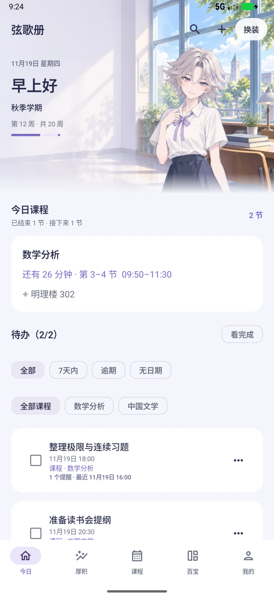

[简体中文](README.md) · **English**


# XianGeCe · 弦歌册

XianGeCe is a campus planner for Android. Look up the room for your next class, mark a moment in a lecture recording, then bring it into a Markdown note after class. Everyday features work without an account. Your timetable, tasks, notes and original recordings stay on your phone by default.

**[Download the Android APK · 1.0.0-preview.5](https://github.com/QwQBiG/XianGeCe/releases/download/android-v1.0.0-preview.5/xiangece-android-1.0.0-preview.5-debug.apk)** · [Release notes and SHA-256 checksum](https://github.com/QwQBiG/XianGeCe/releases/tag/android-v1.0.0-preview.5)

This debug-signed preview runs on ARM phones (`arm64-v8a` and `armeabi-v7a`) with Android 8.0 or later. Android blocks an in-place update if your installed copy uses a different signing certificate. **Before uninstalling the app or restoring a backup, export your data and save your original recordings separately.** App backups omit the audio files, and restoring a backup clears existing lecture recordings from the device.

## From the timetable to your notes

- **Before class**, open Today (今日) to see the next room, check your tasks or change the home character’s outfit. Swipe through teaching weeks in the timetable. When importing a schedule, review the draft before saving it.
- **During a lecture**, record in 谛听 and mark a passage as you hear it. Tap the mark later to play that part again. Recording works offline, and speech recognition models can be installed separately.
- **After class**, write Markdown notes with tables and code blocks, collect lecture excerpts or images, add due dates to the calendar, and keep track of daily habits in 厚积.

<p align="center"><a href="docs/showcase/android-today.webp"></a></p>

<p align="center">The Today screen with sample courses and tasks.</p>

Online recognition and analysis are off by default. When enabling them, you can review the data to be sent and the service that will receive it. [Offline resources](docs/offline-resource-packs.en.md) · [Privacy and backups](docs/privacy-policy.en.md)

## Build from source

Install JDK 17, Android SDK Platform 37 and Python 3. Set `ANDROID_HOME` to your SDK directory, or set `sdk.dir` in the project’s `local.properties`. Run the following commands from the project root. The first downloads and verifies two Android dependencies.

```sh
python3 tools/prepare-android-dependencies.py
./gradlew :app:assembleDebug
```

The APK is written to `app/build/outputs/apk/debug/app-debug.apk`. On Windows, use `gradlew.bat`. To run the local unit tests, use the `:app:testDebugUnitTest` Gradle task. [App source](app/src/main/) · [Dependencies and checksums](app/libs/README.en.md)

## License and contact

The project’s own source code is licensed under Apache-2.0. QwQBiG reserves the rights to the original artwork, including the characters, outfits, scenes and icons. You may build and run the project locally. To reuse the artwork or distribute an app containing it, obtain permission as set out in the artwork terms. Existing GPL rights for the historical release remain in effect. Third-party components retain their respective licenses. [Code license](LICENSE) · [Artwork and historical rights](docs/software-and-artwork.en.md) · [Third-party notices](THIRD_PARTY_NOTICES.en.md)

When reporting a problem, include the app version, your Android version and the steps that led to it. [Project page](https://iqwqi.win/cs/posts/xiangece/)
