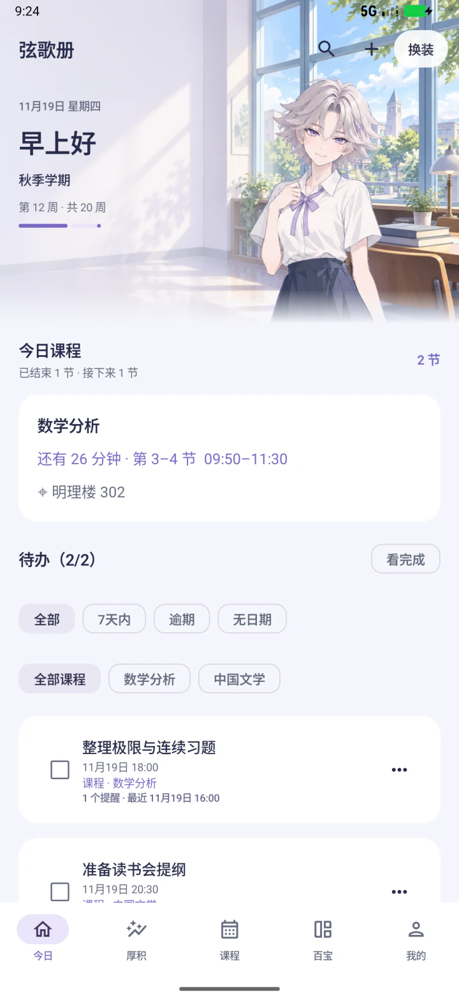

**简体中文** · [English](README.en.md)


# 弦歌册

弦歌册是一本 Android 校园手账。出门前看下一节课在哪间教室，上课时标记想再听一遍的原话，课后把它收进 Markdown 笔记。日常使用无需注册，课表、待办、笔记和课堂原音默认保存在手机上。

**[下载 Android 体验包 · 1.0.0-preview.5](https://github.com/QwQBiG/XianGeCe/releases/download/android-v1.0.0-preview.5/xiangece-android-1.0.0-preview.5-debug.apk)** · [版本说明与 SHA-256 校验](https://github.com/QwQBiG/XianGeCe/releases/tag/android-v1.0.0-preview.5)

适用于 Android 8.0 及以上的 ARM 手机（`arm64-v8a`、`armeabi-v7a`）。此 APK 使用调试签名。如果手机里已有签名不同的旧版，Android 会拒绝覆盖安装。**卸载或恢复备份前，请先导出资料，并单独保存课堂原音。** 应用备份不含原音，恢复备份会清理设备上原有的课堂录音。

## 从课表到课堂笔记

- **上课前**，在「今日」看下一节课的时间、教室和当天待办，也可以给首页人物换装。在课表里滑动切换教学周，导入课表时先核对草稿，再保存。
- **上课时**，打开「谛听」录音，遇到老师强调的内容就做个标记，回看时可以跳回那段原音。保存录音无需联网，离线转写模型可按需安装。
- **课后**，用 Markdown 整理正文、表格和代码块，把课堂片段或图片收进笔记。到日历排好作业截止日期，在「厚积」记录每天的习惯。

<p align="center"><a href="docs/showcase/android-today.webp"></a></p>

<p align="center">「今日」页面 · 图中课程和待办均为演示数据</p>

联网识别和整理默认关闭，启用时可核对发送的内容和接收服务。[离线资源](docs/offline-resource-packs.md) · [隐私与备份](docs/privacy-policy.md)

## 从源码构建

准备 JDK 17、Android SDK Platform 37 和 Python 3。用 `ANDROID_HOME` 指定 SDK 路径，或在工程根目录的 `local.properties` 中配置 `sdk.dir`。在根目录运行以下命令，第一步会下载并校验两个 Android 依赖。

```sh
python3 tools/prepare-android-dependencies.py
./gradlew :app:assembleDebug
```

APK 位于 `app/build/outputs/apk/debug/app-debug.apk`。Windows 使用 `gradlew.bat`。运行本地单元测试可将 Gradle 任务换成 `:app:testDebugUnitTest`。[应用源码](app/src/main/) · [依赖与校验方法](app/libs/README.md)

## 许可与联系

本版自有源码采用 Apache-2.0。原创角色、服装、场景、图标等美术由 QwQBiG 保留权利，允许随工程在本地构建和运行。另行使用这些美术或分发含这些美术的安装包，须按美术授权说明取得许可。历史版已授予的 GPL 权利继续有效，第三方组件按各自条款使用。[代码许可证](LICENSE) · [美术与历史授权](docs/software-and-artwork.md) · [第三方声明](THIRD_PARTY_NOTICES.md)

反馈问题时请注明应用版本和 Android 版本，并说明在哪一步遇到了问题。[项目页面](https://iqwqi.win/cs/posts/xiangece/)
